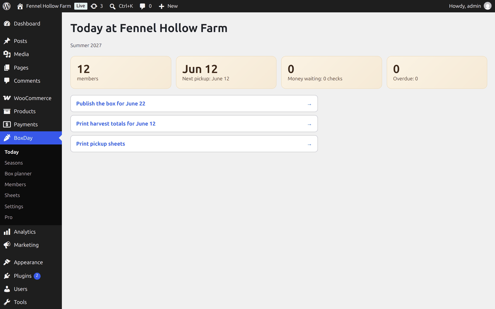
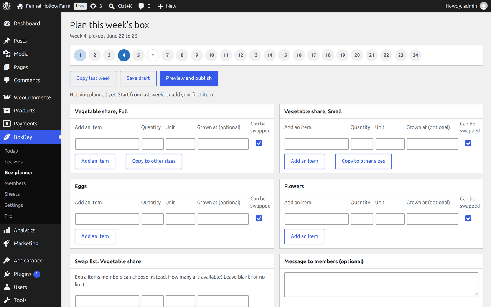
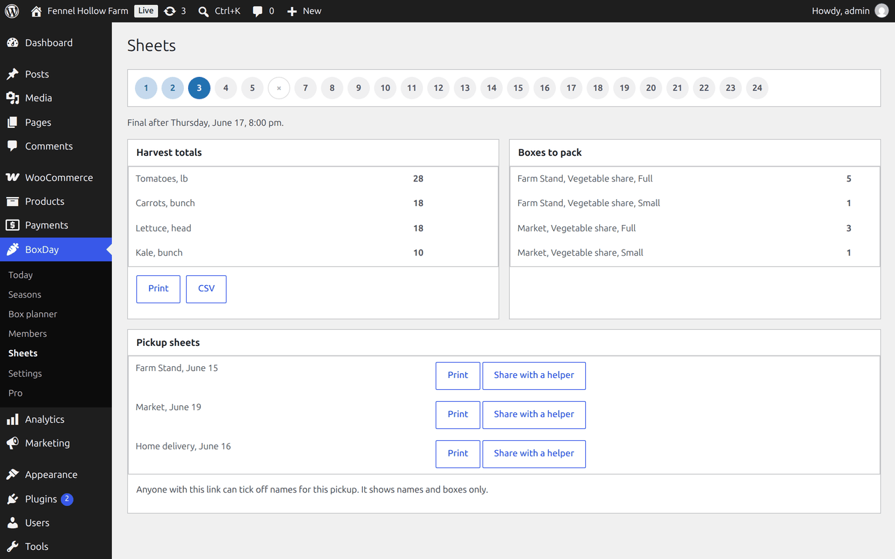
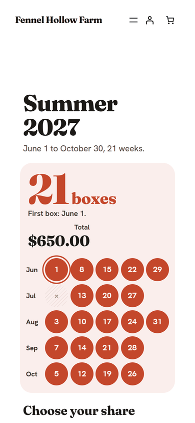
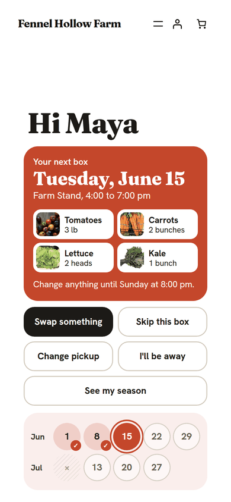

# BoxDay – CSA Farm Shares for WooCommerce

**What it is:** a free WordPress plugin that sells your CSA farm shares and runs the weekly boxes, on your own WooCommerce shop.\
**Who it's for:** small farms that sell a season of weekly or every-other-week boxes (farm shares, veggie boxes).\
**How you use it:** 1. Install it next to WooCommerce. 2. Follow the setup steps to add your season, shares, pickup sites and payment plan. 3. Share your sign-up page, then plan each week's box and print the harvest list and pickup sheets.

It doesn't charge cards by itself, take SNAP/EBT online or host your site: WooCommerce takes the money, on your own website.

**[Download the latest release](https://github.com/Facilo-es/boxday/releases/latest)** · No monthly fee, no share of your sales, no limits on members.

## See it

*Today: how many members you have, the next pickup, money still owed, and the next job to do.*

*Box planner: copy last week's box, change a few crops and publish. Every member gets an email with their box.*

*Harvest totals and pickup sheets: what to pick, how many boxes to pack for each site, and a sheet to print or send to a helper's phone.*

&nbsp;&nbsp;

*Left: members sign up on their phone and pay at your normal checkout. Right: each member's private page, where they swap an item, skip a week or change pickup before your cut-off.*

## What your farm gets

- **More shares sold, earlier.** A sign-up page that works on a phone, full, half and add-on shares, sliding-scale prices, pickup sites and home delivery with a limit for each, and a waitlist that offers freed places for you.
- **Money in without chasing it.** Pay in full, or a deposit and up to 4 more payments, with no fees or interest for members. Reminders go out with a link to pay, and you see who owes what.
- **Fewer emails to answer.** Members swap items, skip weeks and move pickups themselves, up to your cut-off, from a private link with no password.
- **Your Monday back.** Plan the box from last week's, see exactly what to harvest and how many boxes to pack, print pickup sheets or send helpers a phone link.

The free plugin is complete: no limits on members, seasons, shares or sites, and no locked features.

## Questions

**How are instalment payments charged?**
Members pay each one themselves; nothing is charged automatically and no card is stored. When a payment is due, BoxDay creates a WooCommerce order and emails the member a link to pay it: 7 days before the date, on the date, and 3 days after if it's still unpaid. The same "Pay" button is on their member page. For checks or cash, you mark the payment as paid by hand.

**Do I need WooCommerce Subscriptions or a particular payment gateway?**
No. You need WooCommerce (free), nothing else. Members pay with whatever payment methods your WooCommerce checkout already offers.

**Do members need an account or password?**
No. Each member gets a private link by email, and can ask for a new one if they lose it.

**Is BoxDay Pro per site?**
Yes. One Pro licence covers one site, with unlimited members.

**What support is there?**
Email [support@facilo.es](mailto:support@facilo.es), for the free plugin and for Pro; Pro buyers get priority. Every release gets security fixes for 5 years (see [SECURITY.md](SECURITY.md)).

**How do I get updates?**
For now, through the [GitHub releases](https://github.com/Facilo-es/boxday/releases): download the new `boxday.zip` and upload it over the old one (click **Watch → Custom → Releases** to be told). Once BoxDay is listed on wordpress.org, updates will arrive in your WordPress dashboard like any other plugin.

## BoxDay Pro: earn more from every member

Let members build their own box, sell extras like eggs and bread with it, fill next season early with renewal links and early-bird prices, print box labels and route sheets, and see your money and who came back.

**[Get BoxDay Pro](https://checkout.freemius.com/plugin/44230/plan/77947/)** for USD 79 / EUR 75 a year for one site, with a 14-day money-back guarantee. If you stop paying, everything keeps working; only new features and support end.

## Install

1. Download `boxday.zip` from the [latest release](https://github.com/Facilo-es/boxday/releases/latest).
2. In WordPress, go to **Plugins → Add New → Upload Plugin**, choose the zip and activate it. WooCommerce must be active.
3. Open **BoxDay** in the admin menu and follow the setup steps, or load the sample farm to look around first.

Requires WordPress 6.6+, WooCommerce and PHP 7.4+.

## Who makes it

BoxDay is made by [Facilo](https://facilo.es), a small studio in Andalusia. Questions: [support@facilo.es](mailto:support@facilo.es). Security reports: see [SECURITY.md](SECURITY.md). Licensed GPLv2 or later.
