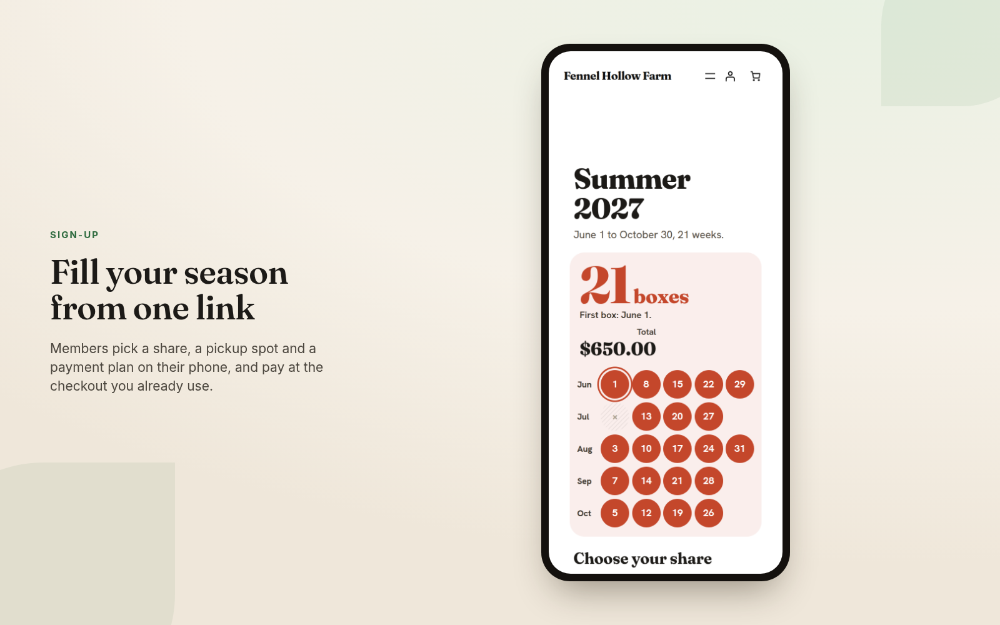
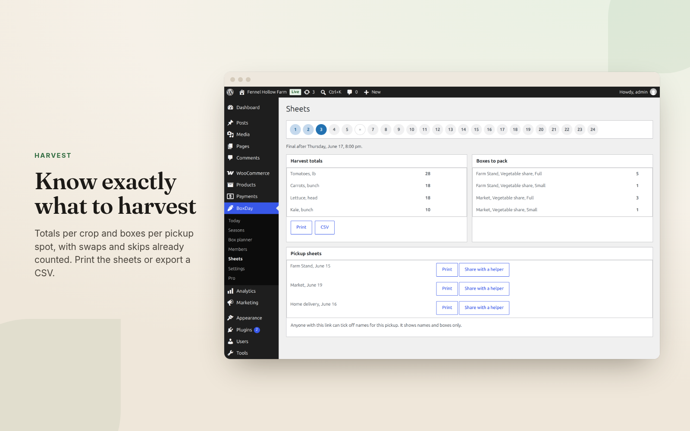

# BoxDay – CSA Farm Shares for WooCommerce

**Fill your CSA from your own website, and keep your season's money.** No monthly fee, no share of your sales.

BoxDay fills your farm shares through your own site, lets members sort out their own swaps and away weeks, and hands you a harvest list and pickup sheets every week. Members pay at your normal WooCommerce checkout, with the payment methods you already use, and their details stay on your site.

## What your farm gets

- **More shares sold, earlier.** A sign-up page that works on a phone, full, half and add-on shares, sliding-scale prices, pickup sites and home delivery with a limit for each, and a waitlist that offers freed places for you.
- **Money in without chasing it.** Pay in full, or a deposit and up to 4 more payments, with no fees or interest for members. Reminders go out with a link to pay, and you see who owes what.
- **Fewer emails to answer.** Members swap items, skip weeks and move pickups themselves, up to your cut-off, from a private link with no password.
- **Your Monday back.** Plan the box from last week's, see exactly what to harvest and how many boxes to pack, print pickup sheets or send helpers a phone link.

The free plugin is complete: no limits on members, seasons, shares or sites, and no locked features.

## BoxDay Pro: earn more from every member

Let members build their own box, sell extras like eggs and bread with it, fill next season early with renewal links and early-bird prices, print box labels and route sheets, and see your money and who came back.

**[Get BoxDay Pro](https://checkout.freemius.com/plugin/44230/plan/77947/)** for USD 79 / EUR 75 a year, with a 14-day money-back guarantee. If you stop paying, everything keeps working; only new features and support end.

## Install

1. Download `boxday.zip` from the [latest release](https://github.com/Facilo-es/boxday/releases/latest).
2. In WordPress, go to **Plugins → Add New → Upload Plugin**, choose the zip and activate it. WooCommerce must be active.
3. Open **BoxDay** in the admin menu and follow the setup steps, or load the sample farm to look around first.

Requires WordPress 6.6+, WooCommerce and PHP 7.4+.

## Support and security

Questions: [support@facilo.es](mailto:support@facilo.es). Security reports: see [SECURITY.md](SECURITY.md).

Made by [Facilo](https://facilo.es). Licensed GPLv2 or later.
